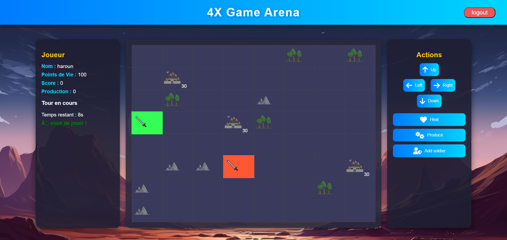
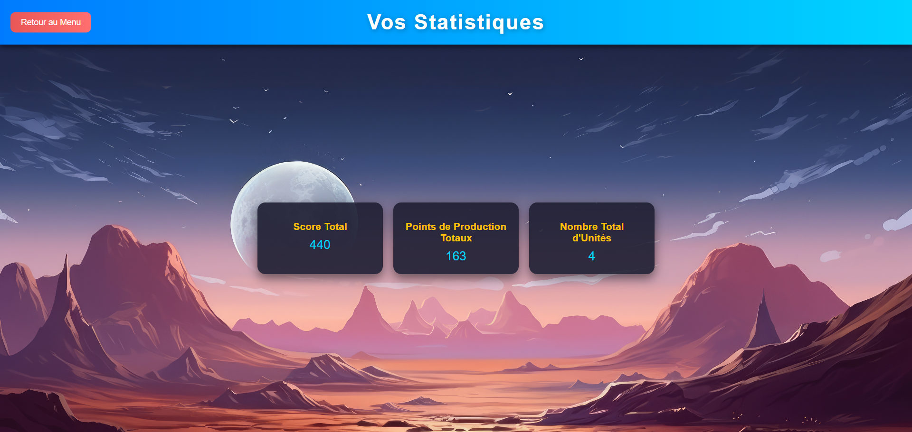

# 4X Game: multiplayer strategy game in JSP/Servlets

A small browser-based strategy game in the "4X" spirit (explore, expand, exploit, exterminate),
written as an individual project for the DEV Web Java (JEE) module at CY Tech, January 2025. Up
to four players log in from their own browser, share one 8x8 map and take 30-second turns to
move a soldier, capture cities, gather production points on forests and fight each other; the
last player with a soldier alive wins. The stack is plain Jakarta EE: JSP pages, HttpServlets,
MySQL through JDBC and some vanilla JavaScript that polls the server, with no framework and no
build tool, which was the point of the exercise.



## How a game runs

1. `login.jsp`: register or log in. Passwords are stored as SHA-256 hashes; logging in sets
   `is_connected = 1` on the player row, and the server refuses a fifth connected player.
2. `mainMenu.jsp`: play, statistics (the totals kept in the `player` table: score, production
   points, cities captured, shown by `stat.jsp`) or logout.
3. `game.jsp`: the arena. The page calls `GameStateController` every 500 ms to redraw the grid
   from a JSON description of the map, and `TurnController` every second for the current player
   and the seconds left. Actions go through `fetch` to `ActionsController`; the arrow keys work too.
4. `game-over.jsp`: shown when your soldier dies or you are the last one standing, with this
   game's stats and the cumulative totals.

## Rules, as implemented in `ActionsController`

- `Carte` builds the map once per server start: 3 cities (30 defense points each), 5 mountains
  and 5 forests placed at random on the 8x8 grid. Each connected player gets a soldier with
  100 HP on a free tile. Mountains and cities owned by someone else cannot be entered.
- Moving onto a city you do not own attacks it: the city loses 1 to 6 defense points, your soldier
  loses 5 HP and you gain 2 production points. At 0 defense you walk in, the city takes your
  colour, and you get +50 score and +15 production.
- Moving onto another player's soldier hits it for 10 to 30 HP; you stay where you are.
- `Produce` only works on a forest tile: +5 production and +10 score. `Heal` costs 10 production
  and gives back 15 HP (capped at 100). `Add soldier` costs 15 production and drops a new soldier
  on a random free tile.
- Every valid action ends your turn; otherwise the turn passes by itself after 30 seconds
  (`TurnManager`, a singleton that cycles through the connected players).
- Your game ends when your soldier reaches 0 HP, or with a win when you are the only player left
  with a soldier. Either way your totals are added to the database and you are disconnected.

## Code layout

```
src/com/projet/
  controller/    LoginController, MainMenuController, GameStateController,
                 ActionsController, TurnController, DatabaseServlet (JDBC connection)
  model/         Carte (8x8 grid of TileContainer), Tuile and its subclasses
                 Ville, Montagne, Foret, Soldat, plus Joueur and StatsSnapshot
  turn/          TurnManager (turn order and 30-second timer)
  utils/         GameUtils, GameState, PlayerPosition
*.jsp            login, mainMenu, game, stat, game-over, with styles/ and images/
WEB-INF/         web.xml (servlet mappings) and lib/ (MySQL Connector/J)
db/schema.sql    creates the three tables (player, soldier, ville)
docs/            slides of the defence (French) and screenshots
```

The map lives in memory as a static `Carte` inside `GameStateController`; the database keeps the
players, the position and health of each soldier, and the totals. On every poll the server reloads
the soldiers from the database and places them on the grid, so all sessions see the same map.

## Running it

Java 17 or newer, Tomcat 10.1 or newer (Jakarta Servlet 6) and MySQL 8.

1. Create the database: `mysql -u root -p < db/schema.sql`.
2. Check the connection settings at the top of `DatabaseServlet.java`
   (`jdbc:mysql://127.0.0.1:3306/4x_game`, user `root`, empty password) and change them if needed.
3. Compile the servlets into `WEB-INF/classes` with Tomcat's servlet API on the classpath:
   `javac -d WEB-INF/classes -cp "$CATALINA_HOME/lib/servlet-api.jar" $(find src -name "*.java")`.
   On Windows: `dir /s /b src\*.java > sources.txt`, then
   `javac -d WEB-INF\classes -cp "%CATALINA_HOME%\lib\servlet-api.jar" @sources.txt`.
4. Copy the project folder to `$CATALINA_HOME/webapps/4x_game` (it is laid out as an exploded
   WAR), start Tomcat and open `http://localhost:8080/4x_game/login.jsp`.
5. For several players, log in from different browsers or private windows: each one gets its own
   session and its own soldier.

## Limitations

- Extra soldiers bought with `Add soldier` cannot be controlled: every action looks up the first
  soldier of the player.
- Logging out removes the session but does not reset `is_connected`, so a player who leaves keeps
  a turn slot until the row is fixed by hand. The map is also rebuilt at every server restart
  while soldier positions survive in the database.
- The client polls (500 ms for the map, 1 s for the turn); WebSockets would remove the lag and
  the useless traffic.
- Passwords are hashed with unsalted SHA-256, the database credentials are hard-coded for local
  development, and there are no automated tests.


